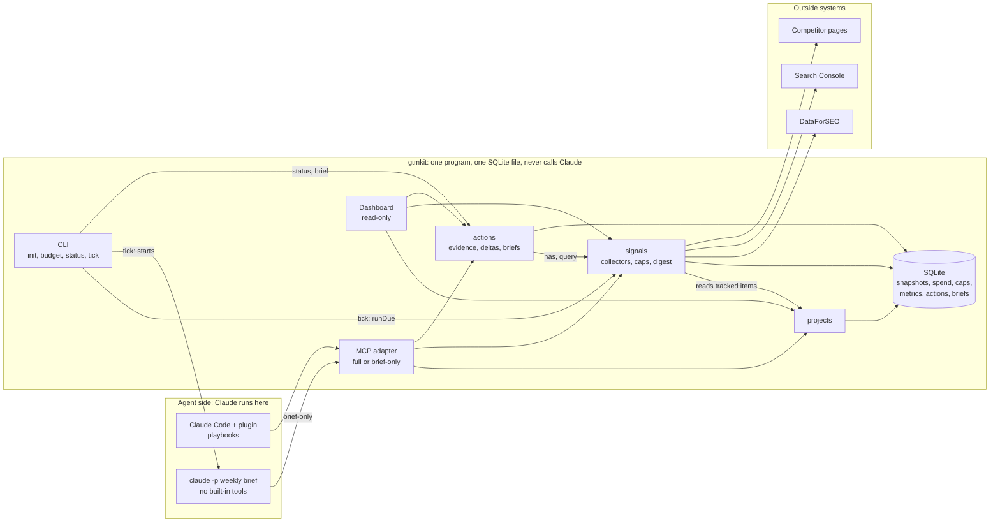

# gtmkit: design v5, as built

Working name. A local-first go-to-market analytics tool for a solo developer who ships several products. Date: 2026-11-14. v5 records what implementation changed from the approved v4. S0 has not run, so every provider fact marked unverified is still unverified.

## 1. Problem and scope

The owner launches new projects and wants each one to get a competent GTM baseline on the channels they can own: SEO, keywords, competitor analysis, AI-search visibility. They want to plug the tool into a new project in minutes, run the AI work on their own Claude subscription locally, and later let other people run it.

Kind of work: new project. No fixed contracts.

Out of scope: publishing content, paid ads, email, social posting, CRM, multi-tenant SaaS with billing, proving that an action caused a metric change.

## 2. Goals

- G1. A documented setup (install, `gtmkit init`, add the plugin, run `/gtm-onboard` in the repo) plugs a new project in and produces a first keyword and competitor picture in under 10 minutes. Prerequisite: a DataForSEO account, minimum top-up $50.
- G2. The tool keeps history without a model running: own search performance, ranks, AI visibility, competitor pages.
- G3. Each week the owner gets a stored, evidence-backed list of GTM actions per project, and later sees how each done action's target metric moved.
- G4. All Claude work runs on the owner's subscription locally. The server needs no Anthropic key in any mode.
- G5. The same program runs in a container for other people, who bring their own agent and data-provider keys.
- G6. Adding a signal type is one new collector file, with no edit to the digest, the MCP adapter or the schema.
- G7. No MCP tool and no unattended run can change a spend cap. Spend stays within the caps as long as the price table is right, a wrong price table is detected within one `tick`, and the prepaid DataForSEO balance is the outer bound in every case. An interactive agent with shell access acts with the owner's own permissions and is outside this guarantee.

## 3. Forces

Functional flows:

- FR1. Owner registers a project: domain, brand names, location, language, competitors, seed topics, positioning notes.
- FR2. Owner asks the agent for keyword research: ideas, volume, difficulty, each keyword stored with a cluster and intent label.
- FR3. Owner asks for competitor analysis: competitor ranked keywords, keyword gap, backlink summary (backlinks arrive in S4).
- FR4. Scheduler imports the project's own Google Search Console performance (free, covers own positions at any depth).
- FR5. Scheduler records the top 30 results for tracked keywords, to see which competitors hold them. **Spends money.**
- FR6. Scheduler records AI visibility for tracked prompts: whether the brand is mentioned or cited. **Spends money.**
- FR7. Scheduler snapshots watched competitor pages and records text diffs.
- FR8. Owner runs a site audit of their own pages. **Spends money.**
- FR9. Agent produces a weekly brief per project: what changed, proposed actions with evidence, content briefs. The brief is stored. Owner accepts, drops or completes actions. Tool reports the metric delta of done actions.
- FR10. Owner opens a read-only dashboard of trends, briefs and actions.
- FR11. Another person deploys the container and connects their own agent.

Non-functional (A marks a written assumption, not an owner answer):

- NFR1 Load (A): 1 user, up to 10 projects, 100 tracked keywords (max 200) and 30 tracked prompts per project, weekly cadence. Peak scheduled run: 2,000 SERP calls and 600 LLM-response calls.
- NFR2 Cost (A): per-project cap $30 per UTC calendar month and a global cap $150, both hard.
- NFR3 Consistency: the spend ledger must not stay below what the provider charged. It is reconciled against the provider's own account figures on every scheduled run, provided S0 confirms those figures are readable by API. Other data may lag one period.
- NFR4 Latency: MCP read tools p95 under 500 ms from the local store. An interactive collection returns within 125 s.
- NFR5 Availability: local is best effort. A laptop asleep at schedule time catches up on the next run, once, no backfill. Cloud (A): one instance, restarts acceptable, RPO 24 h.
- NFR6 Security: provider credentials on disk. Fetched pages, SERP text and LLM answers are untrusted and reach an agent.
- NFR7 Team: one developer who is also the operator. No on-call. Local scheduling targets macOS (launchd). On Linux the same command runs from cron.
- NFR8 LLM quality: every proposed action cites stored evidence (enforced in code). The owner accepts at least 60% of proposed actions over the first four weekly briefs, read from action statuses by `gtmkit status`.

## 4. Classification

| Part | Label | Reason |
|---|---|---|
| Market data (SERP, keywords, backlinks, AI answers, page checks) | Generic | Bought from DataForSEO. |
| Scheduling, history and the spend ledger | Supporting | Simple append-only data. The ledger gets extra care because of NFR3. |
| Project profile, digest, briefs, actions and their deltas | Core | Turning data into tracked decisions per project is what existing tools lack. |
| GTM playbooks | Core | The judgment the owner wants automated. |
| Dashboard | Supporting | Read-only view. |
| Auth (cloud) | Generic | One token per instance. |

## 5. Outside systems

- **Claude subscription and CLI.** `claude -p` can authenticate with a subscription token for scripts (code.claude.com/docs/en/authentication). Offering subscription login to third parties is not allowed: "Unless previously approved, Anthropic does not allow third party developers to offer claude.ai login or rate limits for their products, including agents built on the Claude Agent SDK" (code.claude.com/docs/en/agent-sdk/overview). MCP sampling in Claude Code has no documented support. Consequence: the server never calls Claude. Claude is always the client. Tool restriction (code.claude.com/docs/en/cli-reference): `--allowedTools` only pre-approves tools. `--tools ""` removes all built-in tools. `--strict-mcp-config --mcp-config <file>` loads only the named MCP servers. Unverified: whether `claude -p` started by launchd can read the login keychain. Fallback: a token from `claude setup-token` passed as `CLAUDE_CODE_OAUTH_TOKEN`.
- **DataForSEO.** Pay as you go. Google organic SERP live: $0.002 per 10 results, each further 10 results costs the same again, so depth 30 is $0.006. Standard queue is $0.0006 per 10. Google Ads volume: $0.09 live per task of up to 1,000 keywords, 12 live requests per minute. Labs: $0.012 per task plus $0.00012 per item. Backlinks: $0.024 per task plus $0.000036 per row. LLM Responses live: $0.0006 per task plus model cost. Limits: 10,000 requests per minute, 30 simultaneous, live timeout 120 s. Full-site On-Page crawl is task-post plus polling. Single-page checks (Instant Pages) are live. Unverified, all checked in S0: whether prices include the 2026-07-01 increase, whether every response carries a `cost` field, the model cost per LLM response, whether the account balance is readable by API, and whether AI Overview presence comes free in the SERP response. Unverified and not needed while D9 holds: terms for redistributing data.
- **Google Search Console API.** 1,200 queries per minute per site, 25,000 rows per request, data lags 2 to 3 days. Unverified, checked in S0: whether a service account added as a property user can read Search Analytics. Fallback: a personal OAuth desktop client, exempt from verification for personal use, with the refresh token kept in the credentials file.
- **OpenSEO** (github.com/every-app/open-seo, MIT, about 27k stars). TanStack Start on Cloudflare Workers, Docker self-host, hosted tier at $10 per month, DataForSEO only, MCP over HTTP with OAuth, ships agent skills. Covers keyword research, rank tracking, backlinks, audits, AI visibility, Search Console. Not found, judged from file listings and not a full read: per-project spend caps, tracked actions, competitor page watching.

## 6. Capacity

| Rate | Peak | Limit | Result |
|---|---|---|---|
| SERP calls per scheduled run | 2,000 | 10,000 per minute, 30 simultaneous | Under 5 minutes at 10 concurrent |
| Volume lookups | 10 tasks | 12 per minute | Fine |
| SQLite writes | about 3,000 rows per run | one writer at a time | Fine |
| SERP money, 100 keywords, depth 30, weekly, live | 100 x $0.006 x 4.33 = $2.60 per project per month | $30 project cap | Fine |
| Same at 200 keywords | $5.20 | $30 project cap | Fine |
| Same at 200 keywords daily | $36 | $30 project cap | Exceeds. Daily tracking needs the standard queue, see D5 |
| AI visibility, 30 prompts, 2 engines, weekly, assumed $0.02 per answer | $5.20 | $30 project cap | Fine if S0 confirms the per-answer cost. If it is higher, the default prompt count drops until the kind costs at most $5 per project per month |
| All scheduled spend at NFR1 maximum | 10 x ($5.20 + $5.20) = $104 per month | $150 global cap | Fits, leaves $46 for on-demand research |
| Storage | about 160 MB per year for 10 projects | laptop disk | Fine |

The bottleneck is money, not throughput. Language and deployable count do not move it.

## 7. Candidates

- **C1. Skills only.** A Claude Code plugin, the official DataForSEO MCP server, markdown files per repo. No server. Meets FR2, FR3, FR8, FR9 without stored history. Fails FR4 to FR7 (a model would run work that has clear rules), FR10, FR11, G7.
- **C2. OpenSEO as the data plane.** Self-host OpenSEO and add a small sidecar for actions and page watching. Meets FR2 to FR6, FR8, FR10, FR11 on day one, which is its strong case. It loses on two forces. NFR2: no per-project monthly cap was found, only the prepaid balance bounds spend. G3: the digest and evidence checks would read another product's internal schema, which changes without notice.
- **C3. Own small program (recommended).** One Bun program, one SQLite file, deterministic collectors, one scheduler entry point, an MCP server, a read-only dashboard, and playbooks. It never calls Claude.

C2 wins if the owner drops the action loop and per-project caps. C1 wins if history and distribution are dropped. A fourth shape, one always-on local daemon serving HTTP MCP as in cloud mode, would remove cross-process claims but adds a process to keep alive on a laptop, so stdio plus a daily `tick` is kept.

## 8. The design (C3)

### Modules

One deployable, three modules. Each owns its tables and exposes one interface. Edge adapters (MCP, CLI, dashboard) depend on modules, never the reverse, enforced by an oxlint import rule in CI.

- **projects**: profile (domain, brand names, location, language, competitors, positioning) and tracked items (keywords with cluster and intent label, prompts, watched URLs). Simple CRUD.
- **signals**: getting and keeping data. Interface: `collect(project, kind, subject, dryRun)`, `query(project, kind, subject, range)` (newest first, 20 rows by default, 100 at most), `digest(project, period)`, `has(project, snapshotIds)`, `runDue()`, `setCap(scope, usd)`, `caps()`, `clearHalts()`, `status()`, `rebuildMetrics()`. Hides provider clients, timeouts, retries, concurrency, freshness, dedupe, the spend ledger and the caps. Reads tracked items from `projects`.
- **actions**: proposed actions with evidence, target metric, status, delta. Also stores briefs. Calls `signals.has` and `signals.query`.

### Collectors

A collector is one file exporting:

- `kind`
- `schedule`: `"weekly"` or `{ freshnessDays: n }`
- `provider`: which client `fetch` receives (`dataforseo`, `gsc` or `web`). A collection is refused when that provider is not configured.
- `subjects(project)`: the project's tracked snapshot subjects. This is what `runDue()` collects and what `digest` counts as expected.
- `request(project, subject): { subject, params }`: turns the caller's subject into the snapshot subject and the provider request. Data that `fetch` stores but does not send sits under `params.keep` and is left out of `params_hash`, so editing it does not buy the subject again in the same period.
- `discover(project, web)`, optional: when the caller names no subject, the subjects to collect, read from a free page fetch. `site_audit` reads the sitemap this way. Each subject becomes its own snapshot after the whole set's estimate fits the caps.
- `estimate(params): usd`, an upper bound. Every collector sets a result limit, so the payload stays under 200 KB and the price is bounded. Where a provider returns more, the collector keeps the top rows by its own ranking and the rest is not stored.
- `fetch(params, provider): { payload, costUsd? }`
- `extract(payload, prev): Metric[]` where `Metric = { subject, key, date, value }` and `prev` is the subject's previous stored payload, for metrics that measure change
- `diff(prev: Payload | null, cur: Payload): Change[]` where `Change = { subject, summary, magnitude }`

`digest` loops over collectors, calls `diff` per snapshot subject, sorts by `magnitude` and keeps 20 per kind. It has no per-kind code.

A snapshot's subject is the unit of one provider call. A metric's subject is the thing measured.

| Kind | Snapshot subject | Schedule | Metric keys |
|---|---|---|---|
| `keyword_ideas` | seed topic | 30 days | none, items stay in the payload |
| `keyword_volume` | `"tracked"` (one batch of the tracked keywords) | 30 days | `volume`, `difficulty` per keyword |
| `competitor_keywords` | competitor domain | 30 days | `ranked_keywords` |
| `keyword_gap` | competitor domain | 30 days | `gap_keywords` |
| `gsc_performance` | project domain | weekly | `clicks`, `impressions`, `position` per query (top 1,000 by clicks), and the site total under the metric subject `TOTAL` |
| `serp_top30` | keyword | weekly | `position:<domain>` for the project and each competitor |
| `ai_visibility` | prompt and engine | weekly | `mentioned`, `cited` (0 or 1) |
| `page_watch` | URL | weekly | `changed_chars` |
| `site_audit` | page URL (Instant Pages, up to 100 sitemap URLs) | 7 days | `issues` |
| `backlinks_summary` | domain | 30 days | `referring_domains`, `backlinks` |

`ai_visibility` buys LLM answers as data from DataForSEO (default engines ChatGPT and Perplexity). "Mentioned" means a brand name appears as a whole word, case-insensitive. "Cited" means the project domain appears in the answer's sources.

All DataForSEO collectors use live endpoints. There is no pending-task state.

### Time

- A **bucket** is the UTC slot a snapshot belongs to. Weekly kinds use the ISO week. Freshness kinds use `floor(unix_day / freshnessDays)`, so a repeat inside the window returns the stored snapshot at no cost.
- `runDue()` collects weekly kinds only. Freshness kinds run on demand. A weekly kind is **due** when the current ISO week has no `ok` snapshot for a tracked subject. `tick` runs daily, so collection happens on the first day of the week the machine is awake.
- `gsc_performance` fetches the 7 days ending 3 days before the run.
- A brief is due when the current week has no brief row and `runDue()` has finished for that project. It covers the current week against the previous one.

### Data

One SQLite file in WAL mode with a 5 s busy timeout. Several short-lived processes open it: one stdio MCP server per Claude Code session, the scheduled `tick`, and `serve`. Backup is `VACUUM INTO`. Credentials are never in the database. They live in `~/.gtmkit/credentials` (mode 0600) or the environment.

- `projects`, `tracked_items`. A project id matches `^[a-z0-9][a-z0-9-]{0,63}$` and may not be `global`, `default` or start with `halt`, because ids share the `caps.scope` column and name log files. `project_upsert` refuses more than 200 keywords, 30 prompts or 20 watched URLs per project.
- `caps`: `(scope, usd)` where scope is a project id, `default` or `global`. Cap rows are written only by `gtmkit init` and `gtmkit budget`, which ask in the terminal and refuse when stdin is not one. A project without its own row uses `default`. With no `global` or no `default` row every collection is refused. The table also holds `halt:<kind>` rows, written by `signals` and cleared only by `gtmkit budget --clear-halt` in a terminal.
- `snapshots`: source of truth for data. `(id, project_id, kind, subject, bucket, params_hash, status, claim_token, captured_at, payload)`. Unique on `(project_id, kind, subject, bucket, params_hash)`. Status is `claimed`, `ok` or `failed`.
- `spend`: source of truth for money. Append-only. `(id, snapshot_id, attempt, project_id, kind, month, estimate_usd, actual_usd, at)`. One row per provider call attempt. Rows are never deleted. The only update allowed sets `actual_usd` once on the row of the attempt that returned. Both rules are SQLite triggers. Reconciliation adjustment rows have no snapshot and no project, so they count against the global cap only.
- `metrics`: derived from snapshots. `(project_id, kind, subject, key, date, value)`. Rebuilt by `gtmkit rebuild-metrics`.
- `runs`: `(id, at, phase, balance_usd, ledger_usd)`. One row at the start and one at the end of every `runDue()`: the last tick, and the DataForSEO balance next to the settled ledger total.
- `actions`: `(id, project_id, title, rationale, evidence snapshot ids, target kind/subject/key, status, baseline, done_at)`. Status: `proposed`, `accepted`, `done`, `dropped`.
- `briefs`: `(project_id, period, markdown, created_at)`.

Write path for one provider call:

1. In one `BEGIN IMMEDIATE` transaction: claim the snapshot row with a new `claim_token` (insert, or take over a `failed` row, or a `claimed` row older than 10 minutes). If another process holds a fresh claim, return "in progress" and make no call. Check that this month's `sum(coalesce(actual_usd, estimate_usd))` plus the estimate fits the project cap and the global cap. Insert the `spend` row at the estimate. Commit.
2. Call the provider. Timeouts: 125 s DataForSEO, 30 s Search Console, 15 s and 2 MB for page fetches. Interactive calls are never retried. Scheduled calls retry up to 2 times on network errors and 5xx, never after a timeout, and each retry runs all of step 1 again as a new attempt.
3. `UPDATE snapshots ... WHERE claim_token = ?` to `ok` or `failed`, and set `actual_usd` if the provider reported a cost. The cost write does not depend on the claim: it is recorded when the call failed, when the response could not be decoded, and when the claim was lost. If the database is busy past the timeout, the cost is appended to `<db>.costs`, and the next reconciliation applies each line once and counts unreadable lines.

A crash, timeout or lost claim leaves the spend row at its estimate, so the ledger over-counts while the price table is right.

A wrong price table is caught two ways. If a reported cost is above its estimate, the collector writes a `halt:<kind>` row and that kind refuses calls in every process until the owner updates the table and clears the halt from the terminal. At the start and end of every `runDue()`, in local and cloud mode alike, `signals` reads the DataForSEO account's total spent (or, if only the balance is exposed, the balance drop, which a manual top-up between readings can hide), compares it with the ledger, appends a global `spend` adjustment row for any excess, and writes `halt:all` when an adjustment was needed. Only the balance is implemented (`appendix/user_data`, `money.balance`). Before comparing, reconciliation marks claims older than 10 minutes as `failed` and clears their token, so a dead process cannot mask an overcharge and a late completion cannot cause a false halt. The comparison uses totals, so an under-priced kind can be absorbed by over-estimates elsewhere. If S0 shows the balance is not readable, this check is dropped and the prepaid balance, with auto top-up off, remains the only outer bound.

`runDue()` estimates each project's whole due set per kind before starting it. If the set does not fit the caps, that kind is skipped for the period. `digest` reports coverage per kind (subjects collected of subjects expected) and treats missing data as unknown, not as a change.

### Agent surface (MCP tools)

`project_get`, `project_upsert` (profile and tracked items, including cluster and intent labels), `signals_collect` (with `dry_run` returning the estimate), `signals_query`, `digest`, `actions_propose`, `actions_update`, `actions_list`, `brief_save`. Tool inputs are validated with zod.

- `digest(project, period)` compares the period with the one before. Default period: the current week. There is no cursor.
- `actions_propose` rejects an action unless every evidence id exists in that project and a target metric is named.
- `actions_list` returns each done action's delta once 4 weeks have passed since `done_at`: baseline is the target metric's latest value on or before `done_at`, shown next to the current value, with a flag when two done actions share a target. It is labelled a delta, not proof.

`gtmkit mcp --brief-only` registers only `project_get`, `signals_query`, `digest`, `actions_list`, `actions_propose`, `brief_save`.

### Model use

- The server never calls Claude.
- Local interactive: Claude Code on the subscription, with the plugin's playbooks (`gtm-onboard`, `gtm-keywords`, `gtm-competitors`, `gtm-brief`, `gtm-content-brief`, `gtm-audit`). `gtm-onboard` writes `.gtmkit.json` with the project id into the repo so later sessions know the project.
- Local unattended: one launchd job runs `gtmkit tick` daily. `tick` calls `runDue()`, then for each project with a brief due runs `claude -p <gtm-brief playbook text> --tools "" --strict-mcp-config --mcp-config <gtmkit mcp --brief-only> --allowedTools "mcp__gtmkit__*" --output-format stream-json --verbose`, with `ANTHROPIC_*` variables removed from its environment and a 15 minute limit, saving the transcript under `~/.gtmkit/logs`. The run has no built-in tools, no other MCP servers, and a server that does not register `signals_collect` or `project_upsert`. The restriction is enforced by what exists, not by what the model is told.
- `gtmkit status` prints the last tick, coverage, the latest brief per project and the action acceptance rate. `gtmkit brief <project>` prints the latest brief.
- Cloud: the user's own agent connects to the hosted MCP endpoint. The same playbook files are served as MCP prompts, so a cloud user needs no plugin.
- Each playbook is a fixed workflow: known tool calls in a known order, the model judging and writing between them.
- Untrusted text is returned only in fields whose name starts with `untrusted_` (`untrusted_provider_data`, `untrusted_provider_meta`, `untrusted_change`, `untrusted_reason`, `untrusted_failed`), capped at 2,000 characters per item, and escaped in the dashboard. In interactive sessions the owner's normal permission prompts apply. That residual risk is accepted.
- Eval: a frozen fixture database and 10 brief cases run with the same headless command, graded by code (`bun run eval [case] [runs]`).

### Page fetcher

Used by `page_watch` and `site_audit`'s sitemap read, in both modes: http and https only, redirects followed manually with every hop re-checked (at most 5), the resolved address checked at connect time, and loopback, private, link-local, carrier-grade NAT and IPv4-mapped ranges refused, along with benchmarking, documentation, Teredo and local-use NAT64 ranges. The range check is the program's own, because Bun's `net.BlockList` gave wrong answers. Bun sends requests through `HTTP_PROXY`, `HTTPS_PROXY` or `ALL_PROXY` when set, which would skip the address check, so page fetches refuse while any of them is set.

### Deployment

- Local: `bun install` and `bun link` in a checkout (the package is not published), `gtmkit init` (creates `~/.gtmkit`, asks for DataForSEO credentials). The plugin's `.mcp.json` starts `gtmkit mcp` over stdio. `gtmkit schedule install` adds the launchd job, daily at 09:00, carrying the current `PATH`. `gtmkit serve` shows the dashboard on 127.0.0.1 with no login.
- Cloud: the same program in one container, `gtmkit serve --public`: streamable HTTP MCP with a bearer token (`GTMKIT_TOKEN`, at least 32 characters), dashboard behind a login form that sets an HttpOnly cookie (constant-time token compare), TLS from the platform's proxy, SQLite on a volume, credentials from the environment, an internal timer calling `runDue()` at startup and 24 hours after each run, request bodies limited to 1 MB, and `/health`. Caps are set from an interactive shell in the container.

### Stack

TypeScript on Bun, Effect for timeouts, retries, concurrency and schema validation, `bun:sqlite`, the official MCP TypeScript SDK v2 (`@modelcontextprotocol/server` and `client`), zod for tool inputs, server-rendered HTML with inline SVG charts and no chart library, Vite+ (tests run as `bun --bun vp test run`) and oxlint. These are the owner's house rules. No stated force requires Effect. Plain `fetch` with `AbortSignal.timeout` would also carry this load.

## 9. Decisions

- D1. One deployable, three modules. Force: one operator (NFR7).
- D2. The server never calls Claude. The agent is always the client. Force: subscription terms and G4.
- D3. Buy all market data from DataForSEO behind collectors. Force: Generic subdomain.
- D4. Snapshots are the truth for data, an append-only spend table is the truth for money, metrics are derived. Force: NFR3.
- D5. Live endpoints only, weekly cadence, depth 30. Force: no pending state, and money leaves headroom (section 6). Revisit when the owner wants daily tracking or a project's SERP spend passes $20 per month. Then `serp_top30` moves to the standard queue.
- D6. Own positions come from Search Console, paid SERP calls are for seeing competitors. Force: NFR2.
- D7. Caps are enforced inside `signals` before every call and are written only by a terminal command. Force: G7.
- D8. Fixed-workflow playbooks, not an autonomous agent. The unattended run talks to a server that registers six tools and has no built-in tools. Force: steps are known in advance, NFR6.
- D9. Cloud is one instance per owner with their own provider keys. Force: unverified redistribution terms, NFR7. Revisit when a second person asks for a hosted account.
- D10. One `tick` entry point for all scheduled work. Force: NFR5.
- D11. Bun, Effect, SQLite. Force: house rules. Capacity shows no CPU bottleneck.

## 10. Acceptance criteria

Tests set the clock with `GTMKIT_NOW` and use a fake provider that records every charge.

- AC1 (G1, FR1 to FR3). On a machine with Bun, Claude Code and DataForSEO credentials, the setup yields a stored profile, at least 30 tracked keywords each with a cluster and intent label, and a `keyword_gap` snapshot for at least 2 competitors, in under 10 minutes and under $1 of spend.
- AC2 (G7). With the cap at $0, `signals_collect` refuses, names the cap, and makes no provider call. `project_upsert` with a budget field leaves the cap unchanged. `gtmkit budget` with stdin not a terminal refuses. A project created over MCP uses the default cap, and with no default cap its collection is refused.
- AC3 (G2). After a `tick` with no failures, a second `tick` in the same period makes no provider call.
- AC4 (NFR3). With the fake provider, killing the process at random points during 50 collections and rerunning leaves the month's ledger at or above the fake's recorded charges, and no claim older than 10 minutes blocks the rerun. When the fake charges more than the estimate and reports no cost, the next `runDue()` appends an adjustment row and halts collection (this case is proven in S2).
- AC5 (G2, FR4 to FR7). On a fixture database with two weeks, `digest` returns Search Console changes, a new competitor in the top 30, an AI-visibility change, a page diff and per-kind coverage, in one call under 500 ms.
- AC6 (G3). `actions_propose` with an unknown evidence id is rejected.
- AC7 (G3). On the fixture, an action done 4 weeks ago lists baseline, current value, and delta. An action done 1 week ago lists no delta.
- AC8 (D4). `rebuild-metrics` on a copy of the database reproduces the metrics table exactly.
- AC9 (NFR8). The 10 eval cases pass their code checks on three runs each: every action has valid evidence and a target metric, and none has the same target kind, subject and key as a dropped action.
- AC10 (G3, G4, G7, NFR6). `tick` started by launchd with no Anthropic key stores a brief row for each project. A headless run whose prompt orders the model to call Bash and `signals_collect` shows both absent in the transcript's tool list and makes no provider call.
- AC11 (G5, FR11). The container starts with a token and DataForSEO credentials. Claude Code on another machine completes AC1 against it using the served prompts. A watched URL that redirects to 127.0.0.1 is refused. The dashboard without the cookie returns 401.
- AC12 (G6). Adding a fixture collector file makes its kind collectable, queryable and present in `digest` with no other file edited. CI fails when a module imports an edge adapter.
- AC13 (FR8, FR10). `site_audit` over a fixture sitemap stores per-page issues. The dashboard shows a position trend, the latest brief and the action list for a project, with a script tag in a page diff rendered as text.

## 11. Iteration slices

Each slice ships something usable alone. S1 to S6 are built and tested against a fake provider. S0 has not run, for lack of credentials.

- S0. Half-day trial, no product code: one live call per planned DataForSEO kind, record real prices, the `cost` field, the LLM answer cost, the balance endpoint. Try Search Console with a service account.
- S1. Research on demand: `projects`, `signals` with `keyword_ideas`, `keyword_volume`, `competitor_keywords`, `keyword_gap`, the spend ledger and caps, stdio MCP, plugin with `gtm-onboard`, `gtm-keywords`, `gtm-competitors`, the CI import rule. Proves AC1, AC2, AC4.
- S2. History: `gsc_performance`, `serp_top30`, `ai_visibility`, `page_watch` with the fetcher guard, `tick`, `schedule install`, `metrics`, `digest`, `gtmkit status` (tick and coverage). Proves AC3, AC5, AC8, AC12.
- S3. Decisions: `actions`, `briefs`, `gtm-brief`, `gtm-content-brief`, `mcp --brief-only`, the headless weekly run, the eval fixture, briefs and acceptance rate in `status`. Proves AC6, AC7, AC9, AC10.
- S4. More signals: `site_audit`, `backlinks_summary`. One collector file each, plus the `gtm-audit` playbook. Proves the first half of AC13.
- S5. Dashboard. Proves the second half of AC13.
- S6. Cloud: container, HTTP MCP, token and cookie auth, playbooks as MCP prompts, health check. Proves AC11.

## 12. Open questions

Q1 to Q3 are still open: no live provider call has been made, and the one live headless run was started from a terminal, not launchd.

- Q1. Do DataForSEO live responses report cost, and what does an LLM answer cost? S0. If cost is not reported, the ledger keeps the upper-bound estimate.
- Q2. Can a Search Console service account read Search Analytics? S0. Fallback: personal OAuth desktop client.
- Q3. Can `claude -p` under launchd use the subscription login? S3. Fallback: `CLAUDE_CODE_OAUTH_TOKEN` from the credentials file.
- Q4. DataForSEO terms for a hosted service that resells data. Not needed while D9 holds.
